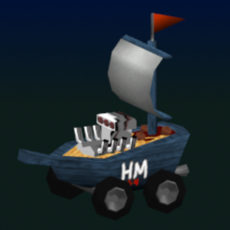

  

# SpaghettiKart — Android

The Android version of [SpaghettiKart](https://github.com/HarbourMasters/SpaghettiKart), the Mario Kart 64 PC
port: the game running natively on Android with touch buttons, full controller support and RetroArch shaders.
Made for Android handhelds with a built-in controller and for phones. Tested on the **AYN Odin 2 Portal**
(Snapdragon 8 Gen 2, 1920×1080, Android 13).

This repository is a fork of the main project: branch `main` follows upstream, branch `android` (the default) is
the Android port. It started from [izzy2lost/SpaghettiKart](https://github.com/izzy2lost/SpaghettiKart), the first
Android port. The main project's README is kept as [README-UPSTREAM.md](README-UPSTREAM.md).

> ⚠️ **No game files.** The app contains only this project's code. You need your own legally obtained ROM of
> **Mario Kart 64 (USA)**, sha1 `579c48e211ae952530ffc8738709f078d5dd215e`.

## Install

1. Download the `.apk` from the [Releases](../../releases) page and open it on the device (allow installing apps
   from your browser or file manager when Android asks).
2. Start **SpaghettiKart** and choose your ROM in Android's file picker. It is checked, and the game files
   (`mk64.o2r`) are extracted from it once — that takes a moment — then the game starts.

Updates install over the previous version and keep your saves. To get them automatically, add this repository to
[Obtainium](https://github.com/ImranR98/Obtainium) (`https://github.com/almost-drowned-rat/SpaghettiKart-Android`).

Needs Android 7.0 or newer (arm64 or 32-bit arm); RetroArch shaders need a 64-bit device with Android 10 or newer
and Vulkan. App ID `io.github.almostdrownedrat.spaghettikart` — it installs next to other SpaghettiKart apps.

## Controls

- **Controller**: works out of the box (built-in handheld controls or a Bluetooth / USB pad); set it up in the
  game's settings.
- **Touch buttons** (N64 layout: stick, A, B, Z, L, R, START, C buttons; D-pad hidden by default), sent to the
  game as a controller, so they can be remapped like any pad. **Automatic** hides them while a controller is used
  and a touch brings them back; **Always** and **Off** are the other modes.
- **Back** (the back gesture, the system bar's back button or a handheld's own Back key) opens the menu over the
  game; Back again closes it.

## Menu

One menu for everything — the game's settings and the Android ones — laid out the same in all of these N64 Android
ports: the sections in a column on the left, the settings as cards on the right, grouped under headings and marked
in the game's colour (red, as the game's own menu).

- **Controller**: D-pad / stick move, **A** select (on a value **A** takes it, left / right change it, **A** or **B**
  lets go), **B** one level back (from the section column it closes the menu), **Y** back to the default,
  **L / R** the section. The hints are at the bottom right.
- **Touch**: tap a card, swipe to scroll; on a value a tap on its left third steps back, on the rest forward.

The sections:

- **General** — Back to game, Exit game; Startup Behaviour, Controller pak screen
- **Gameplay** — Enhancements, Rulesets, Cheats, Freecam
- **Graphics** — picture, frame rate, quality, and the FPS readout
- **Shaders** (below), **Audio**
- **Controls** — the bindings and the touch buttons (mode, move and resize, size, single buttons, opacity, stick
  sensitivity, reset)
- **Developer**, **Mods** (mods and saves managers)

The game stands still while the menu is open. Every setting of the engine's menu is in here; only options without a
function on Android are hidden.

## Shaders

The **Shaders** section has everything in one place:

- **Shader** — On / Off (On takes the preset last used).
- **Shader selection** — the folders and presets of the imported packs. None are shipped: **Import shader pack
  (.zip)** takes a slang shader pack such as [libretro/slang-shaders](https://github.com/libretro/slang-shaders)'
  "Download ZIP"; it is unpacked into the app's folder (`Android/data/io.github.almostdrownedrat.spaghettikart/files/shaders`).
- **Shader resolution** — the picture the shader works on, independent of the game's own resolution (Internal
  Resolution in the game's menu, never changed by this): **Full** (the default: the picture as the game draws it),
  **Original** (scaled down to 240 lines before the shader, as RetroArch feeds a shader the console's picture - the
  look the shaders were made for, and the lightest) or **2x** (480 lines). While the game's own menu is open, the
  shader works on the full picture so the menu stays readable.
- **Shader parameters** — the active preset's settings (kept per preset).
- **Import shader pack (.zip)**

While a shader is in use the game draws into a buffer that goes through the shader onto the screen; switching
between shaders applies at once, from Off to a shader at the next start.

The race renders in 16:9 by default (wider view, not stretched); title and menu screens keep their 4:3 borders. For
4:3 in the race too, set *Settings → Graphics → Force aspect ratio* to *Original (4:3)*.

## Known issues

Report problems on this repository's [Issues](../../issues) page, with the device and Android version. Problems
of the game itself (also on the PC) belong to the [main project](https://github.com/HarbourMasters/SpaghettiKart/issues).

## Building

Install the Android SDK, NDK and JDK 21, apply the patches in [android/patches](android/patches) to the
`libultraship` submodule (`git -C libultraship apply ../android/patches/libultraship-input-editor-spacing.patch`),
then build the APK in `android/` with `./gradlew assembleRelease`; the
Android sources are in `android/` and `src/port/android/`. The game files are not part of the build: the app makes
them from the player's ROM on the device.

## AI assistance

The changes in this Android version were made with AI assistance ([Claude Code](https://claude.com/claude-code)).
Planning, testing on the device and the decision what gets released are by the repository owner. Use at your own
risk. This applies only to this version's own changes, not to the code of the original projects.

## Credits

- [HarbourMasters/SpaghettiKart](https://github.com/HarbourMasters/SpaghettiKart) — SpaghettiKart (see
  [README-UPSTREAM.md](README-UPSTREAM.md)), built on [libultraship](https://github.com/Kenix3/libultraship) and the
  [Mario Kart 64 decompilation](https://github.com/n64decomp/mk64)
- [izzy2lost/SpaghettiKart](https://github.com/izzy2lost/SpaghettiKart) — the Android port this version is based on
- [librashader](https://github.com/SnowflakePowered/librashader) by SnowflakePowered (MIT / MPL-2.0 / GPL-3.0) —
  RetroArch shaders, loaded at run time

*Fan project, not affiliated with Nintendo. Mario Kart 64 is © Nintendo.*
